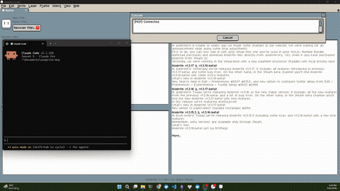
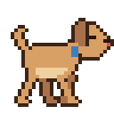

# aseprite-mcp

An [MCP](https://modelcontextprotocol.io) server that lets an AI assistant draw
in [Aseprite](https://www.aseprite.org/) — live, in the real editor, on your
canvas.

## Gallery

<p align="center">
  <br>
  <sub>Live session — Claude Code drawing a pixel-art portrait in Aseprite</sub>
</p>

<table align="center">
  <tr>
    <td align="center" width="200">
      <br>
      <em>Dog walk cycle</em><br>
      Opus 5 · Claude Code<br>
      <sub>Prompt: <em>"Make a dog walking sprite — a walk-cycle animation."</em></sub>
    </td>
    <td align="center" width="220">
      <div style="white-space: nowrap">
        
        →
        
      </div>
      <em>Avatar portrait (from reference photo)</em><br>
      Opus 5 · Claude Code<br>
      <sub>Prompt: <em>"Here's a photo of me — can you draw a pixel-art avatar using it as reference?"</em></sub>
    </td>
    <td align="center" width="200">
      <br>
      <em>Rubber duck</em><br>
      gemma-4-26B-A4B-it-UD-Q4_K_XL · Pi Agent (local, RTX 3060 12GB)<br>
      <sub>Prompt: <em>"Draw a gold rubber duck."</em></sub>
    </td>
  </tr>
</table>

## Install

Two pieces: the **server** (Python, talks to your assistant) and the **plugin**
(Lua, lives inside Aseprite). You need both. Aseprite 1.3 or newer.

### 1. The server

Point your MCP client at `uvx` — there is nothing to install ahead of time.

Claude Code:

```bash
claude mcp add aseprite -- uvx aseprite-mcp
```

Claude Desktop, or any client with a JSON config:

```json
{
  "mcpServers": {
    "aseprite": {
      "command": "uvx",
      "args": ["aseprite-mcp"]
    }
  }
}
```

Multiple sessions can use the same editor. Each command automatically starts or
reuses one shared background bridge; closing the first session leaves the others
connected. Calls run one at a time, and sessions share the active sprite, layer,
frame, selection, and undo history. Sequences of calls may interleave.

The bridge exits after 60 seconds without sessions, once running calls finish.
The plugin reconnects when a later session starts it again. On upgrade from the
old server, stop existing server processes once to free the port. No client
configuration or plugin change is required for shared sessions.

### 2. The plugin

Download `aseprite-mcp.aseprite-extension` from the
[latest release](https://github.com/giangdvdotdev/aseprite-mcp/releases), then
double-click it — or add it from **Edit → Preferences → Extensions → Add
Extension**.

**Restart Aseprite.** Extensions load only at startup. Aseprite's console
(**View → Console**) prints `[MCP] Connected.` once the bridge is up. Either end
can start first; the plugin retries until the server is there and reconnects on
its own afterwards.

### From a clone

```bash
git clone https://github.com/giangdvdotdev/aseprite-mcp.git
cd aseprite-mcp
make install           # Poetry venv in ./.venv with dev extras
make install-plugin    # build + install the plugin, then restart Aseprite
```

Needs [Poetry](https://python-poetry.org/) 2.x. Everything Python runs inside the
project's `.venv`; nothing touches your global interpreter. Run `make` on its
own to list every target.

## Usage

Open Aseprite and ask:

- _"Draw me a 32×32 pixel-art fox."_
- _"Make it blink — duplicate the frame, close the eyes, 120ms each."_
- _"Export the spritesheet to ~/art/fox-sheet.png."_

Thirty tools, all acting on Aseprite's active sprite: drawing (pixels, batches,
lines, rects, ellipses, flood fill, erase), reading back (canvas image, pixels,
regions, layers, selection), undo and redo, frames, open sprites, and PNG or
spritesheet export.

**→ [Full tool reference](docs/TOOLS.md)**

## Configuration

The bridge runs on `127.0.0.1:9876`. To move it, set `ASEPRITE_MCP_PORT` for
**both** ends — nothing negotiates the port, and if only one side changes they
never meet:

```json
"env": { "ASEPRITE_MCP_PORT": "9877" }
```

Aseprite reads its environment at launch, so set the variable before starting
the editor. [Details per platform](docs/TROUBLESHOOTING.md#setting-the-port).

## Troubleshooting

Nearly everything is one of three things: Aseprite is not running, the plugin
was not installed or Aseprite was not restarted after installing it, or the two
ends are on different ports.

**→ [Troubleshooting guide](docs/TROUBLESHOOTING.md)** — every error message the
tools produce, and what to do about it.

## Security

The WebSocket listener is **unauthenticated**. It binds `127.0.0.1` only, so it
is not reachable from other machines, but any process on your own machine can
connect while the server is running and drive Aseprite through it. `export_png`,
`save_sprite`, and `export_spritesheet` write to whatever absolute path they are
given, overwriting what is there. If that is not acceptable in your environment,
do not run the server.

## Contributing

See [CONTRIBUTING.md](CONTRIBUTING.md). Both test suites are fast and neither
needs Aseprite running:

```bash
make test                 # both suites
make test-py              # server (pytest)
make test-lua             # plugin (needs Lua 5.4 on PATH)
```

`make check-versions` confirms the three version strings agree before a release;
`make clean` removes build artefacts, and `make distclean` removes the `.venv`
too.

## License

[MIT](LICENSE).
