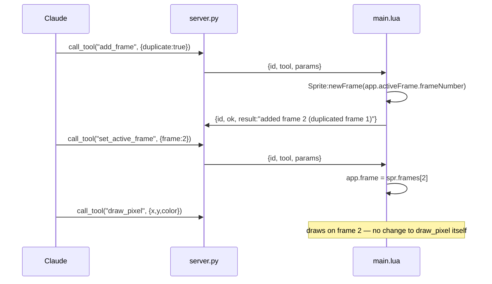

# add-animation-tools — design

## Architecture

### Data flow

No new transport shape. `add_frame`, `delete_frame`, and `set_active_frame`
are write tools returning a short string, matching `add_layer`. `set_frame_
duration` is also a write tool. `list_frames` is a read tool returning an
array, matching `list_layers`'s structure and its place in `dispatch`'s
existing table-vs-string branch.

The dependency this change actually adds is behavioural, not architectural:
every existing draw tool reads `app.activeFrame` (see `draw_pixel`,
`draw_pixels_batch`'s cel lookup, `get_pixel`/`get_region`'s cel lookup), and
none of them change today because `set_active_frame` supplies the only thing
that was missing — a way to move `app.frame` before calling them.

### Interface contract

| Tool | Input | Output | Errors |
|---|---|---|---|
| `add_frame` | `duplicate` bool (default true), `after` int optional (frame number; defaults to the active frame) | `"added frame N (duplicated frame M)"` or `"added empty frame N"` | `no active sprite`; `after must be between 1 and <frame count>` |
| `delete_frame` | `frame` int | `"deleted frame N"` | `no active sprite`; `frame must be between 1 and <frame count>`; `cannot delete the only frame` |
| `set_frame_duration` | `frame` int, `duration` int (milliseconds) | `"frame N duration set to Xms"` | `no active sprite`; `frame must be between 1 and <frame count>`; `duration must be positive` |
| `set_active_frame` | `frame` int | `"active frame set to N"` | `no active sprite`; `frame must be between 1 and <frame count>` |
| `list_frames` | none | array of `{frameNumber, durationMs, isActive}` | `no active sprite` |

All five are idempotent to retry in the sense that matters: a repeated
`set_active_frame`/`set_frame_duration` reaches the same state; a repeated
`add_frame` adds another frame (not idempotent by nature — same as
`add_layer` today); a repeated `delete_frame N` after the first succeeds now
targets whatever frame N currently is, since frame numbers renumber on
deletion, which is documented rather than silently surprising.

## Decisions

### Frame duration crosses the boundary in milliseconds, converted to Aseprite's native seconds internally

- **Chose:** `set_frame_duration(frame, duration)` takes milliseconds;
  `list_frames` reports `durationMs`; the plugin divides/multiplies by 1000 at
  the point it touches `Frame.duration`.
- **Rejected:** passing seconds straight through to match the native property
  exactly, with no conversion.
- **Why:** decided in conversation — frame timing is normally reasoned about
  in milliseconds or fps (12fps ≈ 83ms), and seconds would have the model
  writing fractional values like `0.0833` for a common case, which is an easy
  place to introduce a rounding mistake that a millisecond integer does not
  invite.

### `add_frame` is one tool with a `duplicate` flag, not two tools

- **Chose:** `add_frame(duplicate, after)`, where `duplicate` selects between
  `Sprite:newFrame` (copies cels forward) and `Sprite:newEmptyFrame` (blank).
- **Rejected:** separate `add_frame`/`add_empty_frame` tools.
- **Why:** unlike the shape tools in `add-shape-and-undo-tools` — which stayed
  separate because their *shapes* differ (a line's two endpoints vs. a
  rectangle's bounding box) — the two frame-creation calls take the same
  input and differ only in one boolean's worth of behaviour. That is exactly
  the situation `draw_rect`/`draw_ellipse`'s `fill` flag already covers, and
  the same reasoning applies: one schema, one flag, not two near-identical
  tools.

### `set_active_frame` is new; nothing about the existing nineteen tools changes

- **Chose:** add a tool that sets `app.frame`, and leave every draw/read
  handler exactly as it reads `app.activeFrame` today.
- **Rejected:** adding an optional `frame` parameter to every existing draw
  and read tool so a caller can target a frame without a separate call.
- **Why:** that would touch nineteen schemas and nineteen handlers for a
  capability `set_active_frame` supplies in one call, and it would leave two
  ways to reach the same state (an explicit parameter vs. the active frame) to
  keep consistent with each other forever after. `add_layer` already
  established the precedent of "add a tool that changes what 'active' points
  at, leave everything else alone" for layers; frames follow the same
  precedent.

### Frame numbers are read fresh, never cached across calls

- **Chose:** every handler takes a `frame` parameter as a 1-based frame
  number and resolves it against `spr.frames` at call time; nothing stores a
  `Frame` object or a frame number between calls.
- **Rejected:** returning an opaque frame handle from `add_frame` for later
  calls to reference.
- **Why:** `delete_frame` renumbers every frame after the deleted one, the
  same way removing an array element shifts what follows. An opaque handle
  would either need to survive that renumbering (extra bookkeeping this
  bridge does not otherwise do — cf. `list_layers` identifying layers by name
  and stack index, not a handle) or go stale silently. A plain integer that is
  documented as "the current position, re-read each call" matches how
  `list_layers`' `stackIndex` already behaves.

## Edge cases

- **`add_frame` on a sprite with one frame.** No different from the general
  case — `after` defaults to the active frame, which is frame 1.
- **`add_frame` with `after` out of range.** Rejected with `after must be
  between 1 and <frame count>`, matching the existing range-check convention
  (`get_region`, `get_pixel`).
- **`delete_frame` on the only remaining frame.** Rejected with `cannot delete
  the only frame` if task 1.2 finds Aseprite does not already refuse it; if
  Aseprite does refuse it with its own error, that error is surfaced instead
  of being duplicated.
- **`delete_frame` shifts frame numbers.** Documented in the tool description
  and the README: deleting frame 2 of 5 means what was frame 3 is now frame 2.
  Not treated as a bug to work around — it is how Aseprite's own frame list
  behaves interactively.
- **`set_frame_duration` with a non-positive value.** Rejected with `duration
  must be positive`; Aseprite's own minimum (if any, e.g. a 1ms floor) is
  folded into the same check once task 1.3 reports it.
- **`set_active_frame` to the frame that is already active.** Succeeds
  trivially; not special-cased.
- **`list_frames` on a long animation.** Not capped — `list_layers` has no cap
  either, and frame counts in practice run to the dozens, not the thousands
  `get_region`'s pixel cap exists to guard against.

## Test plan

- **Lua unit (`tests/lua/`):** a pure `ms_to_seconds`/`seconds_to_ms` pair (or
  a single documented conversion point) is the only new logic with a branch
  worth pinning; if the conversion ends up as a one-line arithmetic
  expression with no rounding decision, this is folded into the handler
  instead of extracted, per the project's existing bar for when a helper
  earns its own function (`resolve_shape_tool`, `resolve_color_mode`) versus
  staying inline (per-handler coordinate validation).
- **Python unit (`tests/test_server.py`):** `test_list_tools_matches_registry`
  updated to the twenty-four-tool set; `test_every_tool_has_a_plugin_handler`
  requires no code change and is run to confirm the five new handlers satisfy
  it.
- **Manual, against a live editor** — everything touching `app`, `Sprite`, or
  `Frame`, per CLAUDE.md's "deliberately untested" section: `add_frame` with
  `duplicate=true` copies the previous frame's art; `add_frame` with
  `duplicate=false` is blank; `set_active_frame` followed by `draw_pixel`
  lands on the targeted frame and not frame 1; `delete_frame` renumbers the
  frames after it; `set_frame_duration` followed by `list_frames` reports the
  same value back in milliseconds.
- **Not automatable:** the five handlers' editor-facing halves, and the
  probes in group 1 that stand in for that testing per the project's
  established pattern.

## Performance

Every tool here is O(1) except `list_frames`, which is O(frame count) — no
different in shape from `list_layers`, and animations in scope for a pixel-art
bridge are not going to hold thousands of frames. No new bound is needed.
