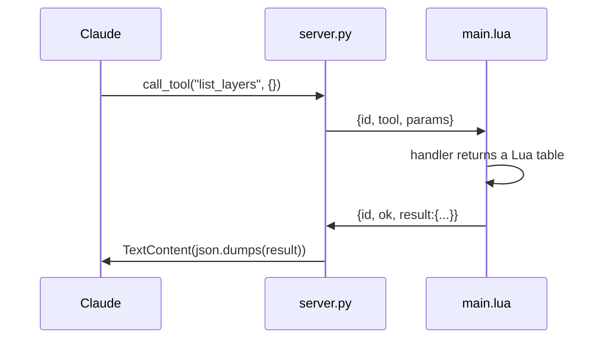
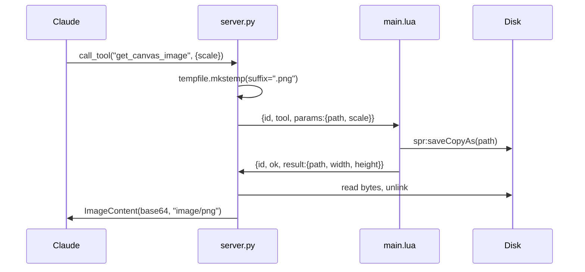

# add-canvas-readback — design

## Architecture

### Data flow

Two shapes of read, deliberately different.

**Structured reads** (`get_sprite_info`, `list_layers`, `get_selection`,
`get_pixel`, `get_region`) travel the existing path. The only change is that the
handler's return value is a Lua table instead of a string, so `dispatch` encodes
it rather than stringifying it. `server.py:_dispatch` already handles a non-`str`
result by `json.dumps`-ing it — that branch has simply never been reachable.

**The canvas image** takes a side path, because a base64 PNG has no business
crossing a WebSocket that carries line-oriented control traffic. The server owns
the file; the plugin only writes to it.

The temp path is generated server-side and never derived from caller input. The
`unlink` sits in a `finally`, so a plugin error, a timeout, or a disconnect all
still clean up.

This relies on both processes sharing a filesystem. They already must: the
WebSocket binds `127.0.0.1`, and `export_png` has always written paths the
plugin resolves locally.

### Interface contract

| Tool | Input | Output | Errors |
|---|---|---|---|
| `get_canvas_image` | `scale` int ≥1, optional | `ImageContent`, PNG | `no active sprite`; `scale must be between 1 and <max>` |
| `get_sprite_info` | none | object: `width`, `height`, `colorMode`, `frames`, `layers`, `activeLayer`, `activeFrame`, `paletteSize`, `filename`, `isModified` | `no active sprite` |
| `list_layers` | none | array of objects: `name`, `stackIndex`, `opacity`, `blendMode`, `isVisible`, `isEditable`, `isGroup`, `isBackground`, `hasCel` | `no active sprite` |
| `get_pixel` | `x`, `y` int | object: `x`, `y`, `color` (`#RRGGBB`), `alpha` 0–255 | `no active sprite`; `no cel at the active layer and frame`; `(x, y) is outside the sprite` |
| `get_region` | `x`, `y`, `width`, `height` int | object: `x`, `y`, `width`, `height`, `encoding`, `rows` | as `get_pixel`, plus `region of N pixels exceeds the 4096-pixel limit` |
| `get_selection` | none | object: `isEmpty`, `x`, `y`, `width`, `height` | `no active sprite` |

All six are read-only and therefore idempotent and retry-safe. None opens a
transaction. `get_canvas_image` writes a file, but to a path the server owns and
deletes, so a retry cannot accumulate garbage.

Error strings follow the existing convention: lowercase, no trailing period,
raised with `error()` in the plugin, surfaced by `_error()` with `isError=True`.
They are load-bearing — README quotes them verbatim.

## Decisions

### Migrate the decoder to native `json`, keep the hand-rolled encoder

- **Chose:** `json.decode` for inbound commands. `json_encode` stays as-is for
  outbound messages.
- **Rejected:** migrating both; migrating neither; keeping the pattern matcher
  as a runtime fallback when `json` is absent.
- **Why:** decode is where the hand-rolled version is actually limited — flat
  objects only, which bounds every future tool's parameter shape. Encode has no
  such limit: it already walks nested tables and arrays, it is unit-tested, and
  swapping it buys nothing while introducing fresh array-versus-object ambiguity
  on the wire. A runtime fallback was rejected because it ships two decode paths
  where the tested one is not the one that runs inside the editor — the worse
  half of both options.

### Command validation lives in a pure `normalize_command`

- **Chose:** `json.decode` does the parsing; a pure `normalize_command(obj)`
  validates that `id` and `tool` are strings and that `params` is a table,
  returning `nil` on anything malformed.
- **Rejected:** validating inline inside `dispatch`.
- **Why:** the `json` global exists only inside Aseprite, so anything calling it
  is untestable in the bare interpreter the Lua suite uses. Splitting parse from
  validation keeps the half that has actual logic testable by passing it plain
  tables, which preserves the repo's rule that pure functions are unit-tested.
  `json.decode` raising on malformed input is caught with `pcall` at the call
  site rather than allowed to escape into `onreceive`.

### The pixel readers read the active cel; only the image reads the composite

- **Chose:** `get_pixel` and `get_region` read `app.cel.image`, offset by
  `cel.position` exactly as `draw_pixels_batch` does, and error when no cel
  exists. `get_canvas_image` returns the flattened, composited sprite.
- **Rejected:** flattening a copy of the sprite per pixel read.
- **Why:** a model that just drew to a layer wants to verify *that layer*, and
  flattening for every sample is both slow and wrong for the question being
  asked. The split gives one tool per question — "what did I paint?" versus
  "what does this look like?" — and reuses a coordinate convention already
  proven against a live editor.

### Regions come back run-length encoded, with a hard cap

- **Chose:** row-major, rows delimited by `|`, runs within a row as
  `count,RRGGBB` delimited by `;`. Hard cap of 4096 pixels (e.g. 64×64) per call.
- **Rejected:** raw `RRGGBB` per pixel; base64 of `Image.bytes`; no cap.
- **Why:** pixel art is mostly flat runs, so RLE is a large win on exactly the
  input this sees — a 64×64 region of four-colour art compresses to a few
  hundred bytes where a raw dump is 24 KB. The delimiter style mirrors
  `draw_pixels_batch` so callers meet one encoding idiom, not two. The cap
  exists because the 10s `TOOL_TIMEOUT` is a shared budget and an uncapped read
  of a large sprite would exhaust it *and* the caller's context; an explicit
  error naming the limit is far easier to act on than a timeout.

### The canvas image is a temp file, not a WebSocket payload

- **Chose:** server-generated temp path, plugin writes with `saveCopyAs`, server
  reads and base64-encodes.
- **Rejected:** the plugin base64-ing `Image.bytes` over the socket; adding
  Pillow to encode raw pixels server-side.
- **Why:** `saveCopyAs` is the one compositing path already proven against a
  live editor — `export_png` uses it. `Image.bytes` is uncompressed, so a 128×128
  RGBA sprite is 64 KB raw and 87 KB base64 through a decoder that has never
  carried a payload that size, and it would still need PNG encoding at the far
  end. Neither alternative justifies a new dependency or a new failure mode.

## Edge cases

- **`json.decode` returns a proxy, not a table.** The docs say "table-like".
  Probed in 1.1 before any handler indexes it; if `type()` is not `"table"`,
  `normalize_command` normalises into a plain table at the boundary.
- **Malformed JSON reaches `json.decode`.** It raises rather than returning
  `nil`. Wrapped in `pcall`; the command is logged and dropped, matching what
  the current parser does when it cannot find an `id`.
- **Multi-frame sprite saved to `.png`.** May produce a numbered sequence rather
  than one file, which would leave the server reading a path that does not
  exist. Probed in 1.2; if confirmed, `get_canvas_image` saves the active frame
  explicitly and the server's read failure returns a real error rather than a
  traceback.
- **Indexed and grayscale colour modes.** `getPixel` returns a palette index in
  indexed mode and a grey/alpha pair in grayscale, not RGBA. `get_pixel` and
  `get_region` branch on `spr.colorMode` and resolve indexed values through
  `spr.palettes[1]` so `color` is always `#RRGGBB` regardless of mode.
- **No cel at the active layer and frame.** Common on a freshly added layer.
  Errors explicitly rather than returning a plausible-looking transparent
  reading that the model would trust.
- **Region partly outside the sprite.** Clipped to the sprite bounds, with the
  returned `x`/`y`/`width`/`height` describing what was actually read. A region
  entirely outside errors.
- **Empty table encoding.** `json_encode`'s array detection sends `{}` as `[]`,
  because an empty table satisfies both branches. Harmless today; wrong for a
  structured result that happens to have no keys. Fixed in 2.4.
- **Sprite closed mid-call.** The handler holds `app.sprite`; if it is gone the
  error surfaces through the existing `pcall` in `dispatch` as an ordinary
  failed call.
- **Temp file left behind.** Server-side `finally` unlinks on every path,
  including timeout and disconnect.

## Test plan

- **Lua unit (`tests/lua/`):** `normalize_command` against well-formed,
  missing-`id`, missing-`tool`, non-table-`params`, and non-string-`id` inputs;
  the region encoder against a single run, alternating pixels, a full row, the
  cap boundary, and a zero-area region; `json_encode` on an empty table.
- **Python unit (`tests/test_server.py`):** `test_list_tools_matches_registry`
  updated to the twelve-tool set; `test_every_tool_has_a_plugin_handler` picks
  up the new handlers with no change; a dict result from the plugin arrives as
  JSON text; `get_canvas_image` returns `ImageContent` on success and unlinks the
  temp file on success, on plugin error, and on timeout.
- **Manual, against a live editor** — the parts that need real canvas state and
  are out of scope for automation per CLAUDE.md: `create_sprite` →
  `draw_pixels_batch` → `get_canvas_image` shows the drawing; `get_pixel` at a
  painted coordinate returns the colour that was written; `get_region` over a
  flat area returns a single run; `list_layers` reflects a hidden layer's
  `isVisible`; the indexed-mode branch of `get_pixel` against an indexed sprite.
- **Not automatable:** everything touching `app`, `Sprite`, `Image`, or the
  canvas, including all six handlers' editor-facing halves. The probes in group
  1 are the substitute, and their findings are written down.

## Performance

`get_region` is the only tool with a real cost curve: it is O(pixels) in Lua
with a `getPixel` call each. The 4096-pixel cap bounds it well inside the 10s
timeout. `get_canvas_image` costs one file write plus one read of a PNG that,
for sprites of this size, is kilobytes. `list_layers` is O(layers). Nothing here
warrants raising `TOOL_TIMEOUT`.
