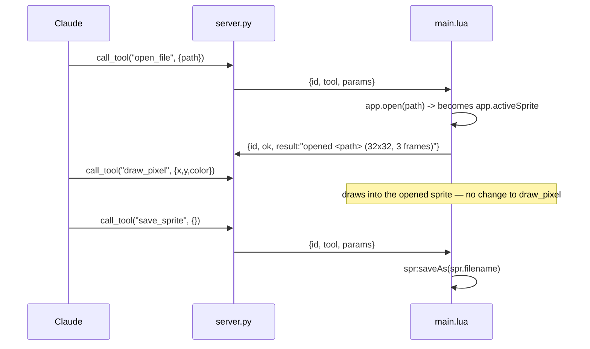
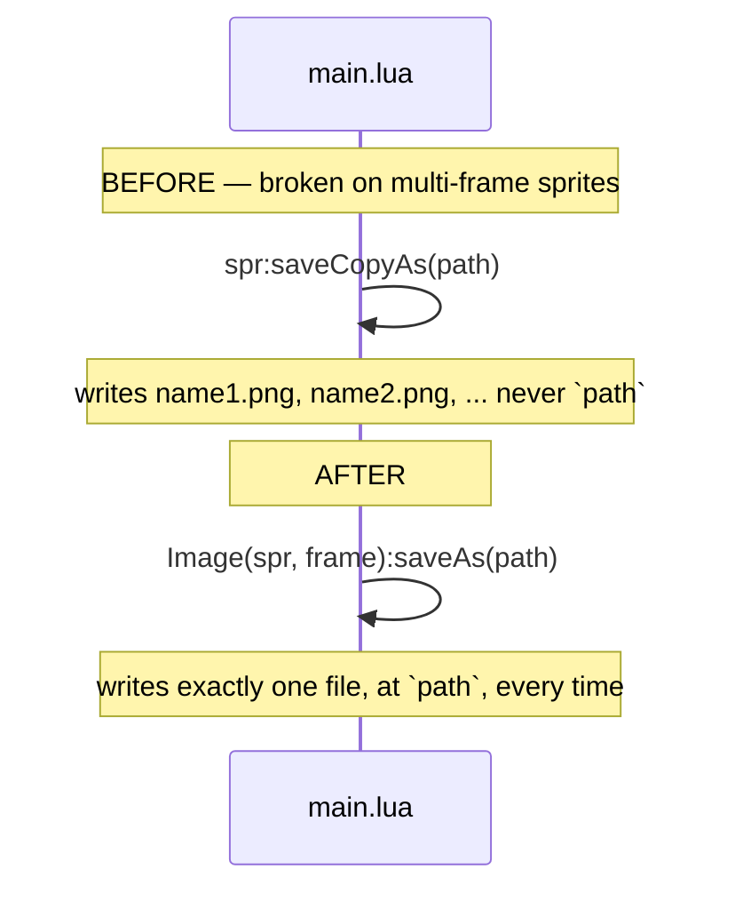

# add-file-and-sprite-tools — design

## Architecture

### Data flow

No new transport shape — every tool here is a write tool returning a short
string except `list_sprites`, which returns an array matching `list_layers`'s
and `list_frames`'s existing pattern.

The behavioural dependency mirrors `set_active_frame`'s from
`add-animation-tools`: nothing about the other twenty-nine tools changes,
because they already read `app.activeSprite`. `set_active_sprite` supplies the
one thing that was missing — a way to move that pointer among more than one
open sprite.

`export_png`'s internal path changes but its external contract does not:

### Interface contract

| Tool | Input | Output | Errors |
|---|---|---|---|
| `open_file` | `path` string | `"opened <path> (WxH, N frames)"` | `path is required`; `could not open <path>: <reason>` (pending 1.2) |
| `save_sprite` | `path` string optional (defaults to the sprite's own filename) | `"saved to <path>"` | `no active sprite`; `path is required — this sprite has not been saved before` (pending 1.1) |
| `list_sprites` | none | array of `{index, filename, width, height, isModified, isActive}` | none — an empty array when nothing is open |
| `set_active_sprite` | `index` int (1-based, matching `app.sprites`) | `"active sprite set to <filename>"` | `index must be between 1 and <sprite count>` |
| `close_sprite` | `force` bool, default false | `"closed <filename>"` | `no active sprite`; `sprite has unsaved changes — save_sprite first, or pass force=true` |
| `export_spritesheet` | `path` string, `columns` int optional | `"exported spritesheet to <path> (WxH per frame, N frames, C columns)"` | `no active sprite`; `path is required`; `columns must be at least 1` |
| `export_png` *(fixed)* | `path` string, `frame` int optional (defaults to the active frame) | `path` (unchanged) | `no active sprite`; `path is required`; `frame must be between 1 and <frame count>` |

`open_file`/`save_sprite`/`close_sprite` are not idempotent in a strict sense
— calling `close_sprite` twice fails the second time with `no active sprite`
or whatever sprite is now active, same as any other tool with nothing open —
but each is safe to retry in the sense that a repeat attempt cannot corrupt
state beyond what the first attempt already would have.

## Decisions

### `close_sprite` refuses an unsaved sprite unless `force` is set

- **Chose:** `close_sprite(force=false)` checks `spr.isModified` before calling
  `Sprite:close()`, and fails with an explicit error naming `save_sprite` or
  `force` as the ways forward, rather than calling `close` and finding out what
  happens.
- **Rejected:** always closing, discarding unsaved work with no confirmation;
  auto-saving before every close.
- **Why:** decided in conversation. The plugin runs inside a live, interactive
  Aseprite instance — `app.isUIAvailable` is true, unlike the `-b --script`
  probes this project runs to verify behaviour — so `Sprite:close()` on a
  modified sprite may pop the same kind of blocking confirmation dialog that
  `app.command` calls are already guarded against with `ui=false` elsewhere in
  this bridge. Checking `isModified` first and refusing by default means the
  bridge never finds out the hard way, and it matches the project's existing
  bias toward explicit, non-destructive defaults (`erase_area` erring on the
  side of a no-op over guessing, `delete_frame` refusing to remove the last
  frame). Task 1.3 still verifies what `force=true` triggers, since refusing
  the common case does not resolve what the forced path actually does.

### `export_spritesheet` is a minimal wrapper, not a passthrough of `ExportSpriteSheet`

- **Chose:** `export_spritesheet(path, columns)` — one PNG, every frame, a
  grid the caller can control only by column count, no JSON data file, no
  trim/padding/tag-filtering parameters.
- **Rejected:** exposing `ExportSpriteSheet`'s full documented surface (layout
  type, rows, padding, extrude, trim, `listLayers`/`listTags`/`listSlices`,
  `dataFormat`/`dataFilename`).
- **Why:** decided in conversation, and consistent with this bridge's existing
  pattern — `get_region`'s RLE encoding, `draw_rect`'s `fill` flag, and
  `add_frame`'s `duplicate` flag are all narrow, opinionated schemas rather
  than passthroughs of Aseprite's own broader command surface. A dozen
  interacting export options would also multiply this change's probe and test
  surface for a feature whose most common use — one flat sheet of every
  frame — needs at most a column count.

### `export_png`'s fix reuses `get_canvas_image`'s compositing technique exactly

- **Chose:** `Image(sprite, frameNumber):saveAs(path)`, the same call
  `get_canvas_image` already uses, now taking an explicit or active frame
  number instead of always the active one.
- **Rejected:** patching `saveCopyAs` with a rename step after the fact (move
  whichever numbered file it produced back to `path`); leaving `export_png`
  single-frame-only and adding a separate `export_frame` tool instead.
- **Why:** `add-canvas-readback`'s probe already did this verification and
  recorded the finding in its own `notes/editor-probe.md` — reusing it needs
  no new probe. A rename-after-the-fact approach depends on `saveCopyAs`'s
  numbering scheme staying predictable and adds a failure mode (which numbered
  file is "the" one requested) that `Image(sprite, frame):saveAs` does not
  have at all. A separate `export_frame` tool was rejected the same way
  `add_frame`/`add_empty_frame` were folded into one tool with a flag: the
  input is identical to `export_png`'s, differing only in which frame is
  composited, so it is one parameter on the existing tool, not a new one.

### `set_active_sprite` indexes into `app.sprites`, not a filename or a stored handle

- **Chose:** a 1-based integer index matching the order `app.sprites` and
  `list_sprites` already report.
- **Rejected:** matching by filename; returning an opaque handle from
  `open_file`/`create_sprite` for later reference.
- **Why:** matches the precedent `set_active_frame` and `set_active_layer`-style
  tools in this bridge already set — a plain, freshly-read index rather than a
  cached identity. A filename match breaks for an unsaved sprite (empty
  `filename`) or two sprites opened from files with the same basename in
  different directories; an opaque handle is bookkeeping this bridge does not
  otherwise do, per the same reasoning `add-animation-tools`' design.md gave
  for frame numbers over frame handles.

## Edge cases

- **`open_file` on a path that does not exist or is not an image/sprite
  Aseprite can read.** Behaviour unverified; task 1.2 determines whether this
  needs an explicit `pcall` and a translated error, or whether `app.open`
  already fails in a way `fail()` can pass through directly.
- **`save_sprite` with no path, on a sprite that has never been saved.**
  `Sprite.filename` is empty in that case (as `get_sprite_info` already
  reports for a fresh `create_sprite`). Rejected with an explicit error naming
  the requirement, rather than attempting `saveAs("")`.
- **`save_sprite` path extension mismatched to content** (e.g. `.png` for a
  multi-frame, multi-layer sprite). Task 1.1 determines whether Aseprite
  rejects this, silently flattens, or writes a format Aseprite itself cannot
  reopen with its layers intact; the finding decides whether the handler
  restricts extensions or passes the caller's choice straight through.
- **`close_sprite` with nothing open.** Errors `no active sprite`, matching
  every other tool's convention.
- **`close_sprite force=true` on the sprite the server is about to need for
  the *next* call.** Not specially handled — closing the last open sprite
  simply means the next tool call that needs `app.activeSprite` reports `no
  active sprite`, same as if nothing had ever been created.
- **`list_sprites` with nothing open.** Returns an empty array rather than an
  error — matches `list_layers`/`list_frames` erroring only when there is a
  sprite to have been asked about layers/frames of, but here there may
  legitimately be none.
- **`set_active_sprite` with an out-of-range index.** Rejected, matching
  `set_active_frame`'s existing range-check convention.
- **`export_spritesheet` on a sprite with one frame.** Not special-cased —
  produces a one-cell sheet.
- **`export_spritesheet` with `columns` greater than the frame count.** Not
  rejected; Aseprite's own layout is expected to handle a column count wider
  than the content, and task 1.4 confirms rather than the handler
  pre-clamping it.
- **`export_png`'s `frame` parameter out of range.** Rejected, matching
  `set_active_frame`'s convention, rather than silently clamping to the
  nearest valid frame.

## Test plan

- **Lua unit (`tests/lua/`):** if `export_spritesheet`'s `type`/enum
  resolution needs a mapping function (per task 1.4's finding, mirroring
  `resolve_shape_tool`/`resolve_color_mode`), it is pure and gets the same
  kind of test coverage they have. Coordinate/path validation stays inline
  per-handler, matching the project's existing bar for when a helper earns
  its own function.
- **Python unit (`tests/test_server.py`):** `test_list_tools_matches_registry`
  updated to the thirty-tool set; `test_every_tool_has_a_plugin_handler`
  requires no code change and is run to confirm the six new handlers satisfy
  it.
- **Manual, against a live editor** — everything touching `app`, `Sprite`, or
  `Image`, per CLAUDE.md's "deliberately untested" section: `open_file`
  against a real `.aseprite` file and a real `.png`; `save_sprite` round-trips
  layers, frames, and tags through a close and reopen; `list_sprites` and
  `set_active_sprite` across two simultaneously open sprites; `close_sprite`
  refusing a modified sprite and succeeding with `force=true`;
  `export_spritesheet` producing a grid whose cell count matches the frame
  count; `export_png` with an explicit `frame` on a multi-frame sprite writing
  exactly one file at the requested path — the regression check for the bug
  this change fixes.
- **Not automatable:** the six new handlers' and `export_png`'s editor-facing
  halves, and the probes in group 1 that stand in for that testing per the
  project's established pattern.

## Performance

Every tool here is O(1) except `list_sprites` (O(open sprite count), no
different in shape from `list_layers`/`list_frames`) and `export_spritesheet`
(O(frame count) inside Aseprite's own command, not this bridge's Lua, so it is
not subject to the same per-pixel-in-Lua budget `get_region`/`erase_area`
are). No new bound is needed.
