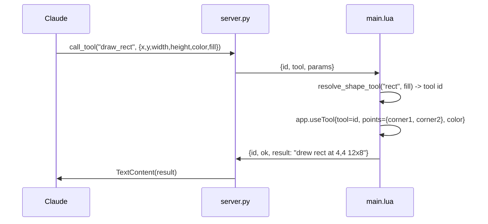

# add-shape-and-undo-tools — design

## Architecture

### Data flow

All seven tools travel the existing structured-result path from
`add-canvas-readback` — no new transport shape. The three shape tools and
`erase_area` are write tools and return a short string, matching
`draw_pixel`/`fill_area`/`draw_pixels_batch`. `get_undo_depth` is a read tool
and returns a table, matching `get_sprite_info`. `undo`/`redo` return a string.

`erase_area` does not call `useTool`; it writes directly to the active cel's
image, the same pattern `draw_pixels_batch` already uses for speed and to avoid
transaction nesting with `useTool`.

### Interface contract

| Tool | Input | Output | Errors |
|---|---|---|---|
| `draw_line` | `x1, y1, x2, y2` int, `color` hex | `"drew line from x1,y1 to x2,y2"` | `no active sprite`; `x1, y1, x2 and y2 are required`; invalid color |
| `draw_rect` | `x, y, width, height` int, `color` hex, `fill` bool (default false) | `"drew rect at x,y WxH"` | as above; `width and height must be at least 1` |
| `draw_ellipse` | same as `draw_rect` | `"drew ellipse at x,y WxH"` | same as `draw_rect` |
| `erase_area` | `x, y, width, height` int | `"erased N pixels"` | `no active sprite`; `x, y, width and height are required`; `width and height must be at least 1` |
| `undo` | none | `"undone"` or `"nothing to undo"` | `no active sprite` (pending 1.2) |
| `redo` | none | `"redone"` or `"nothing to redo"` | `no active sprite` (pending 1.2) |
| `get_undo_depth` | none | `{undoSteps, redoSteps}` | `no active sprite` |

All seven are idempotent to retry in the sense that matters here: a repeated
`draw_rect` redraws the same rectangle, a repeated `erase_area` re-erases an
already-erased region, and a repeated `undo` past the bottom of the stack is
either a no-op or an error per task 1.2's finding — never a crash.

## Decisions

### Shape tools stay separate, with narrow schemas — not one consolidated `draw_shape`

- **Chose:** `draw_line`, `draw_rect`, `draw_ellipse` as three registered
  tools, each taking the coordinates that describe that shape directly (two
  endpoints for a line, a bounding box for rect/ellipse), not a generic
  `points` array or a `shape` enum.
- **Rejected:** one `draw_shape{shape, points, color, fill}` tool covering all
  three.
- **Why:** a consolidated tool trades three small, self-explanatory schemas for
  one schema that is either a lossy generalisation (a bounding box forced into
  a two-element `points` array reads worse than `x, y, width, height`) or a
  union type the model has to disambiguate per shape anyway. Explicit decision
  made in conversation: discoverability per tool outweighs the schema-count
  savings the earlier `improve-tool-api`-adjacent survey favoured, for this
  specific set where the shapes' natural parameterisations differ (line wants
  two points, rect/ellipse want a box).

### `erase_area` writes transparency directly; it does not use the `eraser` tool

- **Chose:** iterate the region and `img:drawPixel(px, py,
  app.pixelColor.rgba(0,0,0,0))` inside `app.transaction`, exactly mirroring
  `draw_pixels_batch`'s cel lookup and `cel.position` offset.
- **Rejected:** `app.useTool{tool="eraser", ...}`.
- **Why:** the interactive eraser's behaviour is mode-dependent — on a
  background layer (which Aseprite does not allow to hold transparency) it
  paints the background colour instead of clearing pixels, and its brush shape
  and opacity interact with tool settings that have no equivalent in this
  bridge. A direct write has exactly one behaviour in every mode, matches how
  `draw_pixels_batch` already writes colour, and needs no new parameters.

### Shape tools go through `app.useTool`, not direct pixel writes

- **Chose:** `useTool{tool=resolve_shape_tool(...), points={...}, color}`
  wrapped in `app.transaction`, matching `fill_area`'s existing pattern.
- **Rejected:** rasterising the line/rect/ellipse in Lua and writing pixels
  directly, the way `draw_pixels_batch` and `erase_area` do.
- **Why:** Aseprite's own tool implementations already handle the geometry
  (Bresenham-equivalent line stepping, ellipse rasterisation) correctly and
  match what a user gets drawing interactively; reimplementing that in Lua is
  extra surface for a subtly-wrong pixel here or there. `draw_pixels_batch`
  bypasses `useTool` for a different reason — per-pixel `useTool` calls are
  orders of magnitude slower for a thousand pixels — which does not apply to a
  single stroke.

### `resolve_shape_tool` is a small pure function, not inlined per handler

- **Chose:** `resolve_shape_tool(shape, fill)` returning the `useTool` tool id
  string, erroring on an unrecognised shape.
- **Rejected:** inlining the `fill and "filled_x" or "x"` check in each of
  `draw_rect` and `draw_ellipse`.
- **Why:** it is the one piece of this change with actual branching logic
  worth pinning in a test, the same reasoning that already applies to
  `resolve_color_mode` and `enum_name`. Coordinate validation (missing x/y,
  non-positive width/height) stays inlined per handler, matching the existing
  style in `draw_pixel` and `get_region` — three near-identical validation
  blocks are not worth a shared abstraction the codebase does not otherwise use
  for this.

### `undo`/`redo`/`get_undo_depth` call `app` directly; no new plumbing

- **Chose:** `app.undo()`, `app.redo()`, and
  `{undoSteps = spr.undoHistory.undoSteps, redoSteps = spr.undoHistory.redoSteps}`.
- **Rejected:** nothing considered — this is the entire surface Aseprite
  exposes for undo.
- **Why:** no decision to make; noted for completeness since task 1.2's
  findings (error vs. no-op at the bottom of the stack) directly become the
  handler's error branch, unlike the shape tools where the geometry has to be
  chosen.

## Edge cases

- **Zero-area or negative-dimension rect/ellipse.** Rejected with `width and
  height must be at least 1`, matching `get_region`'s existing check.
- **Line with identical start and end point.** Not rejected — a degenerate
  line is a single point, which `useTool{tool="line"}` presumably draws as one
  pixel; confirmed as part of task 1.1's probe rather than special-cased in the
  handler.
- **Shape entirely or partly outside the sprite.** Not clipped by the handler;
  `useTool` already clips drawing to the canvas the same way interactive
  drawing does, so no new bounds logic is added on top of it.
- **`erase_area` with no cel at the active layer/frame.** Nothing is painted
  there yet, so the region is already transparent by
  `add-canvas-readback`'s own read semantics (`read_cel_pixel` returns
  transparent outside a cel). The handler returns `"erased 0 pixels"` without
  creating a cel, rather than auto-creating one the way `draw_pixels_batch`
  does — creating a cel purely to leave it transparent has no observable
  effect and would cost a transaction for nothing.
- **`erase_area` on a background layer.** A background layer cannot hold
  transparency in Aseprite's model. Writing alpha 0 there is expected to either
  clamp to alpha 255 or be rejected by the image API; task 1.1's probe list is
  extended to check this so the handler's behaviour is verified rather than
  assumed, and the finding is recorded even though it does not block the
  transparent-layer path this change is written for.
- **`undo`/`redo` at the bottom/top of the stack.** Handled per task 1.2's
  finding — either a documented no-op message or a documented error, decided
  before 3.1/3.2 are written rather than guessed.
- **`undo`/`redo`/`get_undo_depth` with no active sprite.** Sprite-scoped
  (`Sprite.undoHistory`), so `get_undo_depth` follows the existing `no active
  sprite` convention. Whether `app.undo()`/`app.redo()` themselves require one
  is part of task 1.2.

## Test plan

- **Lua unit (`tests/lua/`):** `resolve_shape_tool` for `rect`+fill,
  `rect`+no-fill, `ellipse`+fill, `ellipse`+no-fill, and an unrecognised shape
  erroring with the expected message.
- **Python unit (`tests/test_server.py`):** `test_list_tools_matches_registry`
  updated to the eighteen-tool set; `test_every_tool_has_a_plugin_handler`
  requires no code change and is run to confirm the six new handlers satisfy
  it.
- **Manual, against a live editor** — everything touching `app`, `Sprite`, or
  `Image`, per CLAUDE.md's "deliberately untested" section: `draw_rect` with
  `fill=true` and `fill=false` produce a filled box and an outline
  respectively; `draw_line` and `draw_ellipse` produce the expected shape;
  `erase_area` over previously drawn pixels makes `get_pixel` report alpha 0
  there; `undo` after a draw reverts it and `redo` restores it; `get_undo_depth`
  reflects the counts before and after.
- **Not automatable:** the six handlers' editor-facing halves, and the probes
  in group 1 that stand in for that testing per the project's established
  pattern.

## Performance

Every tool here is O(1) in the number of `useTool`/`app.undo`/`app.redo` calls,
except `erase_area`, which is O(pixels) in Lua exactly like `draw_pixels_batch`
and `get_region`. It needs the same kind of bound those two already have.
`get_region` uses a hard pixel cap; `draw_pixels_batch` has no cap because its
caller already pays per-pixel cost in the request itself. `erase_area` is
closer to `draw_pixels_batch` in shape — a caller names a rectangle, not a
pixel list — so it is closer to `get_region`'s situation: a caller could name
`erase_area` over an entire large sprite in five integers. This change gives it
the same `MAX_REGION_PIXELS` (4096) cap `get_region` already defines, reusing
the constant rather than inventing a second limit.
