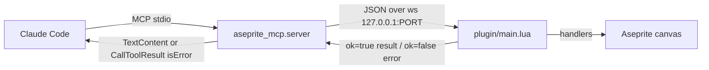

# improve-tool-api — design

## Architecture

### Data flow

The topology is unchanged. What changes is the lifetime of the plugin's socket
handle and the shape of the reply on failure.



The port becomes a variable at both ends, read from `ASEPRITE_MCP_PORT` and
defaulting to 9876. Both ends must agree; nothing negotiates it, so a mismatch
presents exactly as "Aseprite not connected" and is documented as such.

### The reconnect defect

Diagnosed from code, corroborated by the symptoms already recorded in the
README's troubleshooting section.

`ws` is a file-local assigned exactly once, at `main.lua:383`, inside
`connect()`. `send()` is a no-op guarded on that handle:

```lua
local function send(tbl)
  if ws then ws:sendText(json_encode(tbl)) end
end
```

On CLOSE the handler clears it (`main.lua:405`, `ws = nil`), and nothing ever
reassigns it because `connect()` runs once at load. Aseprite's WebSocket object
retries on its own and fires OPEN again — which is why the server logs a fresh
connection — but the handshake `send()` at `main.lua:391` silently does nothing,
and so does every command reply thereafter. That accounts for both recorded
symptoms precisely: a connection with no `Handshake:` line, and every call
waiting the full ten seconds.

The handle is the live object that reconnects, so the fix is to stop discarding
it. Task 1.2 verifies against a live editor rather than trusting this reasoning.

### Interface contract

**`get_sprite_info` (new registered tool)**
- Input: no parameters.
- Output: text describing the active sprite's dimensions and layer count.
- Errors: MCP error when no sprite is active.
- Idempotency: read-only; safe to retry.

**`create_sprite.mode` (parameter becomes functional)**
- Input: `"RGB"`, `"Grayscale"`, or `"Indexed"`, case-insensitive, default `RGB`.
- Output: unchanged confirmation string, extended to name the mode.
- Errors: MCP error naming the accepted values when the mode is unrecognised.
- Idempotency: creates a new sprite per call; not idempotent, unchanged.

**Failed tool calls (semantics change)**
- Every failure path — no connection, timeout, disconnect, `ok=false` from the
  plugin — returns a `types.CallToolResult` with `isError=True` instead of
  success-shaped text. The installed SDK's `call_tool` accepts a returned
  `CallToolResult`, so this needs no protocol workaround.
- Message text is preserved so existing troubleshooting docs stay accurate.

**`ASEPRITE_MCP_PORT` (new configuration surface)**
- Input: an integer in the range 1–65535, read at startup by both ends.
- Output: none; affects which port is bound and dialled.
- Errors: a non-numeric or out-of-range value fails fast at startup with a
  message naming the variable, rather than silently falling back.

## Decisions

### Decision 1 — Retain the socket handle; add no reconnect supervisor
- **Chose:** stop setting `ws = nil` on close, and confirm the handshake arrives
  after a real server restart.
- **Rejected:** a `Timer`-based health check that forces a fresh `connect()`.
- **Why:** the retry already works — the README records the socket reconnecting
  on its own. Adding a supervisor would layer a second retry mechanism over a
  functioning one to fix a bug that lives entirely in a stale local. If live
  verification in task 1.2 shows Aseprite's retry giving up, a supervisor
  becomes justified and gets its own change.

### Decision 2 — Structured MCP errors, unchanged message text
- **Chose:** return `CallToolResult(isError=True)` from the dispatch failure
  paths, keeping the existing human-readable strings.
- **Rejected:** raising exceptions and letting the SDK convert them.
- **Why:** the SDK's exception path produces its own wrapper text, which would
  invalidate the README's troubleshooting section that quotes these messages
  verbatim. Returning the result keeps the strings under our control.

### Decision 3 — Environment variable for the port, read at both ends
- **Chose:** `ASEPRITE_MCP_PORT`, defaulting to 9876.
- **Rejected:** a CLI flag on the server.
- **Why:** MCP clients launch the server from a JSON config where an `env` block
  is standard, whereas threading a flag through `uvx` is awkward. The plugin has
  no command line at all, so a flag could not reach both ends — and both ends
  must agree or the bridge silently fails to form.

### Decision 4 — Verify the plugin can read the environment before relying on it
- **Chose:** probe `os.getenv` inside Aseprite before building on it, and fall
  back to a constant declared in `plugin/package.json` if the sandbox blocks it.
- **Rejected:** assuming the standard Lua library is fully available.
- **Why:** Aseprite's scripting sandbox restricts parts of the standard library,
  and this is unverified. Discovering it after building the feature would strand
  the plugin on a port the server is not listening on.

### Decision 5 — Widen the websockets bound rather than removing it
- **Chose:** migrate to `websockets.asyncio.server` and relax to a bound that
  admits the next major.
- **Rejected:** dropping the upper bound entirely.
- **Why:** the pin exists because an unbounded dependency already threatened to
  break every new install once the deprecated symbol is removed. Migrating
  removes the reason for the current ceiling but not the argument for having one.

## Edge cases

- **Server restarts while a call is in flight:** the pending future is cancelled
  by the existing disconnect cleanup; the caller sees a disconnect error. Now an
  MCP error rather than success text.
- **Aseprite restarts while the server keeps running:** the server clears
  `aseprite_ws` on close, so the fresh connection is accepted. Existing
  behaviour, re-verified after the handle change.
- **Repeated close/open cycles:** the handshake fires on every OPEN, so the
  server logs a handshake per reconnect. Harmless, and the useful signal that
  the fix works.
- **Unknown colour mode string:** rejected with an error naming the accepted
  values, rather than silently falling back to RGB.
- **`get_sprite_info` with no active sprite:** the handler already errors; that
  becomes an MCP error once registered.
- **Port mismatch between the two ends:** presents as "Aseprite not connected".
  Cannot be auto-detected — documented in troubleshooting.
- **Port set to a privileged or out-of-range value:** fails fast at startup.
- **`os.getenv` unavailable in Aseprite:** falls back to the documented constant;
  handled by Decision 4.
- **Two projects each wanting their own bridge:** now possible with distinct
  ports, but each still needs its own Aseprite instance. Not solved here.

## Test plan

- **Lua unit (`lua tests/lua/run.lua`):** colour-mode string mapping, including
  case-insensitivity and the unknown-mode error. The existing JSON and
  `parse_pixels` suites must stay green — the handle change touches
  `connect()`, which those tests never load, so a regression there would signal
  the export guard broke.
- **Python unit (`pytest`):** every dispatch failure path now asserts
  `isError` is set — no connection, timeout, disconnect, and plugin `ok=false`.
  The registry test extends to seven tools, and the existing server/plugin drift
  test then covers `get_sprite_info` automatically. Port resolution gets its own
  tests: default, override, and rejection of a non-numeric value.
- **Manual — the reconnect fix:** the only check that matters and the only one
  that cannot be automated. Start the server, connect Aseprite, restart the MCP
  client, and confirm the server logs a `Handshake:` line and a tool call
  succeeds without restarting Aseprite.
- **Manual — colour modes:** create a Grayscale and an Indexed sprite and
  confirm Aseprite reports the mode, since `ColorMode` only exists in-editor.
- **Manual — port override:** run both ends with `ASEPRITE_MCP_PORT` set and
  confirm they meet.
- **Not automatically testable:** anything requiring the editor — `app.version`,
  `ColorMode`, cel and layer behaviour, and the reconnect cycle itself.

## Performance

Not relevant. No change touches the batch path or alters payload sizes.
