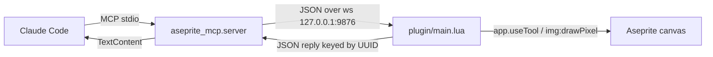

# prepare-oss-release — design

## Architecture

### Data flow

Nothing about the runtime data path changes in this change. It is restated here
because the packaging work moves the entry point, and the trust boundary is what
the README's security note must describe.

Two boundaries matter. The stdio boundary is owned by the MCP client and carries
no untrusted input. The WebSocket boundary listens on `127.0.0.1` only, so it is
not reachable off-host — but it is unauthenticated, meaning any local process can
drive Aseprite while the server runs. That is acceptable for a developer tool and
must be stated plainly in the README rather than discovered.

`export_png` writes to any absolute path the model supplies. This is inherent to
the tool's purpose and is documented, not restricted, in this change.

### Interface contract

**`aseprite-mcp` console script (new public surface)**
- Input: no arguments; MCP protocol on stdin/stdout.
- Output: MCP responses on stdout; human-readable logs on stderr.
- Errors: exits non-zero if port 9876 is already bound. The current code raises a
  bare `OSError` from `websockets.serve`; this change documents the symptom in
  the README troubleshooting section rather than adding handling.
- Idempotency: not applicable — one process, one listener.

**`dist/aseprite-mcp.aseprite-extension` (new public surface)**
- Input: a zip of `plugin/package.json` and `plugin/main.lua`, renamed.
- Output: installed by Aseprite into its per-user extensions directory.
- Errors: Aseprite rejects the bundle if `package.json` is malformed.
- Idempotency: reinstalling over an existing version replaces it; Aseprite must
  be restarted for the new code to load.

**`plugin/main.lua` return value (new, test-facing)**
- Returns a table exposing `json_encode`, `json_decode_params`,
  `json_decode_command`, `parse_pixels`, and `handlers`.
- Calling `connect()` becomes conditional on the Aseprite `WebSocket` global
  being present, so `dofile` from a bare interpreter is side-effect free.

## Decisions

### Decision 1 — Export table + guarded entry point, not a Lua module split
- **Chose:** end `main.lua` with a table of its internals and wrap the
  `connect()` call in a check for the `WebSocket` global.
- **Rejected:** extracting the JSON codec into `plugin/json.lua` and requiring it.
- **Why:** verified today that `dofile("plugin/main.lua")` fails at line 352 with
  `attempt to call a nil value (global 'WebSocket')` — the file runs `connect()`
  at load time and every function is `local`, so nothing is reachable even with a
  stub. The guard fixes both problems in two lines. A module split additionally
  depends on Aseprite's extension loader honouring `require` for sibling files,
  which is unverified and would be discovered only after shipping.

### Decision 2 — Zero-dependency Lua test runner, not busted
- **Chose:** a plain `tests/lua/run.lua` that `dofile`s each `*_test.lua` and
  exits non-zero on failure.
- **Rejected:** `busted` via LuaRocks (LuaRocks is present — it ships with the
  Lua 5.4.6 winget package installed today).
- **Why:** the entire point of this change is lowering install friction. Making a
  drive-by contributor install and configure LuaRocks to run two test files
  contradicts that. A runner is ~20 lines and the assertions are equality checks.

### Decision 3 — `src/` layout and a console script
- **Chose:** move to `src/aseprite_mcp/` with `__main__.py` and a
  `[project.scripts]` entry, so `uvx aseprite-mcp` works with no clone.
- **Rejected:** keeping `server/server.py` and pointing `[project.scripts]` at a
  top-level module via `py-modules`.
- **Why:** `uvx` is the single biggest ease-of-use win available and it needs a
  real installable package. The current `sys.path.insert` hack in the tests is a
  symptom of the same problem and disappears with the move.

### Decision 4 — Pin `websockets`, defer the API migration
- **Chose:** `websockets>=12,<16` in `pyproject.toml`.
- **Rejected:** migrating to `websockets.asyncio.server` now.
- **Why:** confirmed the installed 15.0.1 emits `DeprecationWarning` for
  `websockets.server.WebSocketServerProtocol`; it still works. An unpinned
  install after that symbol is removed breaks every new user, so the pin is
  urgent. Rewriting the transport immediately before a first public release is
  not. Deferred to `improve-tool-api`.

### Decision 5 — Build the extension bundle from `plugin/`, never hand-copy
- **Chose:** `scripts/build_extension.py` zips `plugin/` to
  `dist/aseprite-mcp.aseprite-extension`; `scripts/install_plugin.py` copies it
  into the local Aseprite extensions directory for development.
- **Rejected:** documenting the manual copy path per OS.
- **Why:** the manual path already produced drift in this repo — the fix applied
  today had to be written twice, to `plugin/main.lua` and to the copy under
  `AppData\Roaming\Aseprite\extensions\`. A build step makes `plugin/` the only
  source of truth.

## Edge cases

- **Empty batch string:** `draw_pixels_batch("")` errors with `pixels is required`.
  Already handled; a Lua test pins the behaviour.
- **Malformed pixel entries:** currently skipped silently, so a typo drops pixels
  and only the returned count hints at it. `parse_pixels` will return a skipped
  count and the handler will report it. Covered by task 3.4.
- **Out-of-bounds coordinates:** clipped against the cel bounds. Existing
  behaviour, pinned by test, not changed.
- **Port 9876 already bound:** server fails to start. Documented in README
  troubleshooting; no code change. Explicitly deferred.
- **Server restarts while Aseprite is open:** the plugin never reconnects and the
  user must restart Aseprite. Known limitation — documented in this change,
  fixed in `improve-tool-api`.
- **Second Aseprite instance connects:** rejected with close code 1008. Existing
  behaviour, unchanged.
- **Client config breaks on restructure:** moving `server/server.py` invalidates
  any config pointing at that path. Task 7.1 re-verifies a live round-trip.
- **Auth/permissions:** none. Any local process can drive the socket while the
  server runs. Documented as a security note, not fixed.

## Test plan

- **Python unit (pytest):** existing five tests keep their coverage of dispatch,
  timeout, disconnect, unmatched UUID, and error surfacing. The tool-registry
  test is corrected to the real six-tool set. One new test asserts every tool in
  `list_tools()` has a matching `handlers.<name>` in `plugin/main.lua`, catching
  server/plugin drift.
- **Lua unit (new, `lua tests/lua/run.lua`):** regression coverage for
  `json_decode_params` — comma-bearing payloads, escaped quotes and backslashes,
  booleans, numbers, empty strings — plus `parse_pixels` including malformed and
  out-of-range entries. The parser fix made today already passes 12/12 assertions
  of this shape against Lua 5.4.6; those become the committed suite.
- **Manual — fresh clone:** follow the README verbatim in a temp directory,
  install the built `.aseprite-extension`, and confirm a live `create_sprite`
  round-trips. This is the only check that exercises the real Aseprite runtime.
- **Not automatically testable:** anything requiring the Aseprite process — the
  WebSocket handshake, `app.useTool` behaviour, cel creation, and PNG export all
  need a running editor. The Lua tests deliberately cover only pure functions.

## Performance

Not relevant. Payloads are a few kilobytes, the canvas is 32×32, and the batch
tool already collapses 563 pixel writes into four round-trips. No changes here
affect the hot path.
